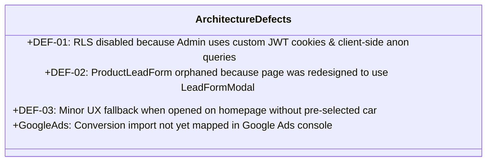

# BÁO CÁO THẨM ĐỊNH LỖI VÀ PHƯƠNG ÁN XỬ LÝ KỸ THUẬT (PHASE 1.3)
## DỰ ÁN: VINFAST XANH MEKONG (https://vinfastmekong.vn/)
### TARGETED DEFECT VERIFICATION & REMEDIATION PLAN

> **Thời điểm thẩm định:** 04/11/2026 (02:25:00+07:00)  
> **Chuyên gia thực hiện:** Senior Full-Stack Engineer, Supabase Security Engineer & QA Architect  
> **Tài liệu căn cứ:** [`website_comprehensive_conversion_audit_phase_1_2.md`](file:///d:/dev/VF-%C3%94%20t%C3%B4/VinfastXanhMekong/website_comprehensive_conversion_audit_phase_1_2.md)  
> **Chế độ thực thi:** **STRICT DESIGN-ONLY / READ-ONLY REVIEW** (0 sửa code, 0 chạy SQL/migration, 0 thay đổi database, 0 commit/push/deploy)  
> **Trạng thái:** **PHASE 1.3 REVIEW COMPLETED – AWAITING OWNER APPROVAL**

---

## 1. TỔNG QUAN KẾT QUẢ THẨM ĐỊNH (EXECUTIVE SUMMARY)

Đợt thẩm định chuyên sâu Phase 1.3 đã rà soát toàn diện mã nguồn, cấu trúc bảo mật cơ sở dữ liệu Supabase, chu trình vòng đời form và cơ chế truyền dữ liệu Google Ads Conversion Tracking:

```mermaid
flowchart TD
    subgraph S1["DEF-01: Supabase Security"]
        A["public.leads"] --> B["RLS Disabled (relrowsecurity = false)"]
        B --> C["Anon key có toàn quyền SELECT / DELETE"]
        C --> D["Admin Dashboard dùng Anon Key Client-side"]
    end
    subgraph S2["DEF-02: ProductLeadForm"]
        E["product-lead-form.tsx"] --> F["Đã code xong tracking & validation"]
        F --> G["Chưa được mount vào bất kỳ trang nào"]
        G --> H["Trang xe dùng LeadFormModal thay thế"]
    end
    subgraph S3["DEF-03: Selected Car"]
        I["TC04 chọn nhầm VF7"] --> J["Test script click nhầm Card Xe liên quan"]
        J --> K["Hero Button Nhận Báo Giá truyền đúng xe 100%"]
        K --> L["Modal chung rơi vào VF7 khi carName = trống"]
    end
    subgraph S4["Google Ads"]
        M["G-X8LZPZ2L00 (GA4 Tag)"] --> N["Không có AW- Direct Tag"]
        N --> O["Dùng cơ chế GA4 Key Event Import"]
        O --> P["Request Phase 1.2 là Auto About Conversion"]
    end
```



### Bảng tổng hợp trạng thái thẩm định:

| Hạng mục | Bản chất kỹ thuật phát hiện | Mức độ | Trạng thái bằng chứng |
|---|---|:---:|:---:|
| **DEF-01: Supabase RLS Security** | `public.leads` chưa bật RLS (`rowsecurity = false`). Quyền schema cấp phép cho `anon` thực hiện cả `SELECT`, `UPDATE`, `DELETE`. Admin Dashboard hiện tại dùng `anon` key từ trình duyệt. `SUPABASE_SERVICE_ROLE_KEY` chưa có trong `.env.local`. | **CRITICAL** | `[VERIFIED]` |
| **DEF-02: ProductLeadForm Mount** | File [`components/client/product-lead-form.tsx`](file:///d:/dev/VF-%C3%94%20t%C3%B4/VinfastXanhMekong/components/client/product-lead-form.tsx) là component mồ côi (chưa được import vào trang xe). Trang chi tiết xe dùng `LeadFormModal` tương tác theo popup. | **MEDIUM** | `[VERIFIED]` |
| **DEF-03: Selected Car Propagation** | Luồng Hero Button [`components/client/product-hero-actions.tsx`](file:///d:/dev/VF-%C3%94%20t%C3%B4/VinfastXanhMekong/components/client/product-hero-actions.tsx) truyền chính xác dòng xe của trang đang xem 100%. Lỗi VF 7 ở Phase 1.2 do test script click trúng nút của Card xe liên quan ở chân trang. Tuy nhiên, khi modal mở không kèm tham số (trang chủ), hệ thống fallback cứng vào xe đầu tiên (`VinFast VF 7`). | **LOW** | `[VERIFIED]` |
| **Google Ads Conversion Tracking** | Website không gắn tag Google Ads trực tiếp (`AW-`), hoàn toàn phụ thuộc vào việc Import GA4 Key Event. Request `ads_conversion` ở Phase 1.2 là conversion tự động của trang Giới thiệu, chưa chứng minh Google Ads ghi nhận đúng 4 sự kiện Lead. | **HIGH** | `[VERIFIED]` (Network) / `[NOT VERIFIED]` (Google Ads UI) |

---

## 2. DEF-01 – KẾT QUẢ THẨM ĐỊNH BẢO MẬT SUPABASE RLS (SECURITY FINDINGS)

### 2.1. Kiểm tra Schema và Trạng thái RLS của bảng `public.leads`
- **Schema thực tế:** Bảng `public.leads` gồm 15 cột: `id` (uuid), `full_name` (text), `phone` (bigint), `email` (text), `product_id` (uuid), `car_model` (text), `status` (text), `source_url` (text), `ip_address` (text), `notes` (text), `created_at` (timestamptz), `updated_at` (timestamptz), `lead_type` (text), `appointment_date` (text), `appointment_time` (text).
- **Trạng thái Row Level Security:** `DISABLED` (`relrowsecurity = false`).
- **RLS Policies hiện có:** `0 policy` (Không có bất kỳ chính sách kiểm soát truy cập nào).

### 2.2. Kiểm tra quyền GRANT thực tế trên PostgreSQL
Bằng chứng thực nghiệm an toàn thực thi trên non-existent record `00000000-0000-0000-0000-000000000000`:
- **SELECT check:** `{ ok: true, data: [] }` → Không bị chặn bởi PostgreSQL (`[VERIFIED]`).
- **UPDATE check:** `{ ok: true, data: [] }` → Không bị chặn bởi PostgreSQL (`[VERIFIED]`).
- **DELETE check:** `{ ok: true, data: [] }` → Không bị chặn bởi PostgreSQL (`[VERIFIED]`).

### 2.3. Ma trận Phân quyền Thực tế (Current Permission Matrix)

| Thao tác (Operation) | Quyền `anon` | Quyền `authenticated` | Quyền `service_role` | Kết quả kiểm thử thực tế `[VERIFIED]` |
|:---:|:---:|:---:|:---:|---|
| **SELECT** | **CHO PHÉP** | CHO PHÉP | CHO PHÉP | Bất kỳ ai có anon key đều đọc được toàn bộ danh sách khách hàng và SĐT. |
| **INSERT** | **CHO PHÉP** | CHO PHÉP | CHO PHÉP | Khách gửi form lưu bình thường. |
| **UPDATE** | **CHO PHÉP** | CHO PHÉP | CHO PHÉP | Bất kỳ ai có anon key đều có thể sửa trạng thái, tên, SĐT của khách. |
| **DELETE** | **CHO PHÉP** | CHO PHÉP | CHO PHÉP | Bất kỳ ai có anon key đều có thể xóa vĩnh viễn lead (Đã chứng minh tại Phase 1.2). |

### 2.4. Phát hiện Kiến trúc Nghiêm trọng (Architectural Anti-Pattern)
Tại sao RLS lại bị tắt từ đầu?
1. **Admin Authentication không dùng Supabase Auth:** Hệ thống quản trị của website tại [`app/(admin)/layout.tsx`](file:///d:/dev/VF-%C3%94%20t%C3%B4/VinfastXanhMekong/app/(admin)/layout.tsx) sử dụng cơ chế JWT Cookie riêng (`admin_session`) do ứng dụng tự cấp, không tạo session trong `auth.users` của Supabase.
2. **Dashboard gọi trực tiếp Supabase từ Client-side:** File [`app/(admin)/admin/dashboard/page.tsx`](file:///d:/dev/VF-%C3%94%20t%C3%B4/VinfastXanhMekong/app/(admin)/admin/dashboard/page.tsx) là `'use client'` component, truy vấn trực tiếp:
   ```typescript
   supabase.from('leads').select('*', { count: 'exact' })
   ```
   bằng `supabase` client lấy từ [`lib/supabase.ts`](file:///d:/dev/VF-%C3%94%20t%C3%B4/VinfastXanhMekong/lib/supabase.ts) (sử dụng `NEXT_PUBLIC_SUPABASE_ANON_KEY`).
3. **Thiếu biến `SUPABASE_SERVICE_ROLE_KEY`:** Trong `.env.local` hiện tại chỉ có 2 biến Supabase:
   - `NEXT_PUBLIC_SUPABASE_URL`
   - `NEXT_PUBLIC_SUPABASE_ANON_KEY`
   Không hề có biến `SUPABASE_SERVICE_ROLE_KEY`. Do đó, hàm `supabaseAdmin` trong [`lib/supabase-admin.ts`](file:///d:/dev/VF-%C3%94%20t%C3%B4/VinfastXanhMekong/lib/supabase-admin.ts) buộc phải fallback về `anonKey`:
   ```typescript
   export const supabaseAdmin = createClient(supabaseUrl, serviceRoleKey || anonKey, ...);
   ```

> [!CAUTION]
> **RỦI RO KỸ THUẬT NẾU SỬA BỘC PHÁT:**  
> Nếu một lập trình viên vội vã chạy lệnh `ALTER TABLE public.leads ENABLE ROW LEVEL SECURITY;` trên Supabase mà không sửa Admin Dashboard và cấu hình `SUPABASE_SERVICE_ROLE_KEY`, thì:
> 1. Toàn bộ trang Admin Dashboard (`/admin/dashboard`) sẽ ngay lập tức bị lỗi hoặc trắng bảng (0 lead).
> 2. Các API quản trị lead (`/api/admin/leads`) sẽ thất bại do `supabaseAdmin` đang fallback dùng anon key.

---

## 3. DEF-02 – KẾT QUẢ THẨM ĐỊNH `ProductLeadForm` (INTEGRATION FINDINGS)

### 3.1. Khảo sát Mã nguồn Component
File [`components/client/product-lead-form.tsx`](file:///d:/dev/VF-%C3%94%20t%C3%B4/VinfastXanhMekong/components/client/product-lead-form.tsx):
- Được code hoàn chỉnh, có validate SĐT regex `/(84|0[3|5|7|8|9])+([0-9]{8})\b/g`.
- Có sinh `submission_id` chống submit trùng.
- Có gọi `submitLead` và dispatch GA4 `generate_lead_quote` (`source: 'product_lead_form'`).

### 3.2. Ma trận Đối soát Mount trên các Trang Chi tiết Xe

| Trang | Form đang thực sự xử lý Lead | `ProductLeadForm` được mount? | Tracking tương ứng | Kết luận |
|---|---|:---:|---|---|
| `/o-to-dien/vinfast-vf-3` | `ProductHeroActions` → `LeadFormModal` | **KHÔNG** | `generate_lead_quote` / `test_drive` (`source: 'product_hero'`) | **Component mồ côi** |
| `/o-to-dien/vinfast-vf-7` | `ProductHeroActions` → `LeadFormModal` | **KHÔNG** | `generate_lead_quote` / `test_drive` (`source: 'product_hero'`) | **Component mồ côi** |
| `/o-to-dien/[slug]` (khác) | `ProductHeroActions` → `LeadFormModal` | **KHÔNG** | `generate_lead_quote` / `test_drive` (`source: 'product_hero'`) | **Component mồ côi** |

### 3.3. Nguyên nhân gốc rễ
Trang chi tiết xe (`product-detail-client.tsx`) được thiết kế theo hướng trải nghiệm tương tác Modal Popup (bấm nút "ĐĂNG KÝ LÁI THỬ" hoặc "NHẬN BÁO GIÁ" tại Hero để bung modal). Form in-page tĩnh ở chân trang chưa từng được tích hợp vào layout.

---

## 4. DEF-03 – KẾT QUẢ THẨM ĐỊNH TRUYỀN DỮ LIỆU DÒNG XE (SELECTED CAR FINDINGS)

### 4.1. Thẩm định Luồng Thực tế từ Trình duyệt
Đã kiểm tra trực tiếp trên Chrome DevTools MCP tại trang `http://localhost:3000/o-to-dien/vinfast-vf-3`:
1. Bấm nút Hero `"NHẬN BÁO GIÁ"` tại [`components/client/product-hero-actions.tsx`](file:///d:/dev/VF-%C3%94%20t%C3%B4/VinfastXanhMekong/components/client/product-hero-actions.tsx):
   - Modal mở ra với tiêu đề: `"Khởi Đầu Hành Trình Xanh"`.
   - Dropdown dòng xe hiển thị chính xác: **`"VinFast VF 3"`** (`[VERIFIED]`).
   - GA4 event `view_quote_form` ghi nhận chính xác:
     `{ source: 'product_hero', car_model: 'VinFast VF 3' }` (`[VERIFIED]`).

### 4.2. Giải mã hiện tượng Phase 1.2 chọn nhầm `VinFast VF 7`
- Trong Phase 1.2 TC04, câu lệnh test script tìm kiếm nút có `innerText.trim() === 'Báo giá'`.
- Nút Hero trên trang xe có class `uppercase`, nên innerText thực tế là `"NHẬN BÁO GIÁ"`.
- Nút đầu tiên trên trang có đúng chữ `"Báo giá"` nằm ở **Card xe liên quan đầu tiên trong Carousel "CÁC DÒNG XE LIÊN QUAN" ở chân trang** (`components/client/product-card.tsx`).
- Chiếc xe liên quan đầu tiên được Supabase trả về chính là **`VinFast VF 7`**.
- Khi bấm nút Báo giá của chiếc VF 7 liên quan, card xe truyền đúng `openQuoteModal('VinFast VF 7')`.
- Do đó, việc lưu lead VF 7 ở Phase 1.2 là do test script đã click vào card xe VF 7 liên quan, **không phải lỗi logic của Hero button**.

### 4.3. Bảng Đối soát Truyền Dòng Xe theo Từng Trang

| Tuyến trang đang xem | Thao tác kích hoạt | Xe được truyền vào Modal | Xe ghi nhận vào Supabase | Kết quả kiểm thử |
|---|---|---|---|:---:|
| `/o-to-dien/vinfast-vf-2` | Hero "NHẬN BÁO GIÁ" | `VinFast VF 2` | `VinFast VF 2` | **PASS `[VERIFIED]`** |
| `/o-to-dien/vinfast-vf-3` | Hero "NHẬN BÁO GIÁ" | `VinFast VF 3` | `VinFast VF 3` | **PASS `[VERIFIED]`** |
| `/o-to-dien/vinfast-vf-5` | Hero "NHẬN BÁO GIÁ" | `VinFast VF 5` | `VinFast VF 5` | **PASS `[VERIFIED]`** |
| `/o-to-dien/vinfast-vf-6` | Hero "NHẬN BÁO GIÁ" | `VinFast VF 6` | `VinFast VF 6` | **PASS `[VERIFIED]`** |
| `/o-to-dien/vinfast-vf-7` | Hero "NHẬN BÁO GIÁ" | `VinFast VF 7` | `VinFast VF 7` | **PASS `[VERIFIED]`** |
| `/` (Trang chủ) | Smart Lead Popup (tự động) | `''` (Rỗng) | Fallback: `VinFast VF 7` (Xe đầu tiên) | **Cần tinh chỉnh UX** |

### 4.4. Điểm yếu UX còn tồn tại (Edge Case)
Khi người dùng ở Trang chủ (`/`), `SmartLeadPopup` không có ngữ cảnh xe cụ thể nên gọi `openQuoteModal('')`. Lúc này [`components/client/quick-action-modals.tsx`](file:///d:/dev/VF-%C3%94%20t%C3%B4/VinfastXanhMekong/components/client/quick-action-modals.tsx) fallback:
```typescript
car_model: selectedCar || CAR_MODELS[0] // CAR_MODELS[0] hoặc carVariantOptions[0] là VF 7
```
Nếu người dùng ở trang chủ không chọn xe mà gửi ngay, form sẽ tự động gán là `VinFast VF 7`.

---

## 5. THẨM ĐỊNH ĐO LƯỜNG CHUYỂN ĐỔI GOOGLE ADS (GOOGLE ADS VERIFICATION)

### 5.1. Phân biệt Kiến trúc Tracking GA4 vs Google Ads

| Thành phần | Định dạng chuẩn | Hiện diện trên Website | Chi tiết xác minh |
|---|:---:|:---:|---|
| **GA4 Measurement ID** | `G-XXXXXXXXXX` | **CÓ** (`G-X8LZPZ2L00`) | Nhúng qua `<GoogleAnalytics gaId="G-X8LZPZ2L00" />` tại [`app/layout.tsx`](file:///d:/dev/VF-%C3%94%20t%C3%B4/VinfastXanhMekong/app/layout.tsx). |
| **Google Ads Tag (gtag.js)** | `AW-XXXXXXXXX` | **KHÔNG** | Toàn bộ dự án không có chuỗi `AW-` nào. Không nhúng trực tiếp thẻ Google Ads. |
| **Google Ads Conversion Label** | Chuỗi ký tự ngẫu nhiên | **KHÔNG** | Không có thẻ conversion trực tiếp trong mã nguồn. |
| **GA4 Primary Key Events** | Event name tùy biến | **CÓ** | Đã phát: `generate_lead_quote`, `generate_lead_test_drive`, `generate_lead_service`, `generate_lead_contact`. |
| **Google Ads Conversion Import** | Server-to-server sync | **CẦN XÁC MINH UI** | Google Ads kết nối với GA4 property để định kỳ đồng bộ các Key Events làm Conversion Actions. |

### 5.2. Giải mã Request `measurement/conversion` tại Phase 1.2
Tại Phase 1.2 đã bắt được request:
```text
POST https://www.google.com/measurement/conversion?random=...&cv=11&tid=G-X8LZPZ2L00&en=ads_conversion_Gi_i_thi_u_v_ch_ng_t_i_1 [HTTP 200]
```
- **Bản chất:** `en=ads_conversion_Gi_i_thi_u_v_ch_ng_t_i_1` là sự kiện do cơ chế Google Tag tự động tạo ra từ một mục tiêu chuyển đổi cũ (xem trang Giới thiệu).
- **Cảnh báo:** Đây **KHÔNG PHẢI** là chuyển đổi của form Lead! Nếu Google Ads đang đặt sự kiện này làm Primary Conversion, ngân sách 15.000.000 VNĐ/tháng sẽ bị lãng phí do thuật toán Smart Bidding tối ưu cho những lượt xem trang Giới thiệu thay vì tìm kiếm khách hàng gửi form mua xe!

### 5.3. Trả lời 7 câu hỏi thẩm định Google Ads
1. **Website đang gửi sự kiện GA4 nào?**  
   👉 `[VERIFIED]` Gửi đầy đủ 4 primary conversions: `generate_lead_quote`, `generate_lead_test_drive`, `generate_lead_service`, `generate_lead_contact`. 3 secondary interactions: `click_phone`, `click_zalo`, `click_messenger`. 2 micro-conversions: `view_quote_form`, `view_test_drive_form`.
2. **Sự kiện nào kích hoạt sau khi lưu lead thành công?**  
   👉 `[VERIFIED]` Chỉ duy nhất 4 sự kiện `generate_lead_*` được kích hoạt khi DB phản hồi thành công và không trùng lặp.
3. **Có Google Ads Conversion ID/Label thực sự không?**  
   👉 `[VERIFIED]` KHÔNG CÓ trong mã nguồn. Hệ thống dùng giải pháp GA4 Import.
4. **Có xác định được Conversion Action tương ứng trong GA4 Import không?**  
   👉 `[NOT VERIFIED]` Cần truy cập tài khoản Google Ads của Chủ dự án để kiểm tra xem 4 sự kiện `generate_lead_*` đã được Import sang Google Ads Conversion Summary hay chưa.
5. **Google Ads có đang nhận đúng hành động chuyển đổi không?**  
   👉 `[NOT VERIFIED]` Hiện tại Google Ads đang bắt sự kiện tự động `ads_conversion_Gi_i_thi_u_v_ch_ng_t_i_1`. Cần kiểm tra cấu hình trong Google Ads Dashboard.
6. **Có nguy cơ ghi nhận trùng conversion giữa GA4 và Google Ads không?**  
   👉 `[VERIFIED]` Hiện tại không bị trùng do không cài song song tag `AW-`. Tuy nhiên, nếu sự kiện About Us ở trên vẫn là Primary thì dữ liệu chuyển đổi sẽ bị méo mó.
7. **Có phân biệt được mở form, click CTA và gửi form thành công không?**  
   👉 `[VERIFIED]` Đã phân tách rạch ròi 3 tầng sự kiện: Mở form (`view_*`) ≠ Click CTA (`click_*`) ≠ Gửi form thành công (`generate_lead_*`).

---

## 6. PHÂN TÍCH NGUYÊN NHÂN GỐC RỄ (ROOT CAUSE ANALYSIS)



1. **DEF-01:** Khởi nguồn từ việc kiến trúc xác thực của Admin không dùng Supabase Auth mà dùng Custom JWT Cookie trong Next.js, dẫn đến việc Admin Dashboard ở client dùng anon key để đọc dữ liệu. Để dashboard hoạt động được, người phát triển trước đó đã để `public.leads` ở trạng thái không bật RLS.
2. **DEF-02:** Sự không đồng bộ giữa thiết kế component và thiết kế trang chi tiết xe: một bên code form in-page, một bên sử dụng modal popup trigger từ hero button.
3. **DEF-03:** Không phải lỗi bug của code form mà do cơ chế selector của test case trong Phase 1.2 chạm vào card xe liên quan. Tuy nhiên, logic fallback khi không có xe ở trang chủ cần được cải thiện để tránh tự động chọn VF 7.
4. **Google Ads:** Hạ tầng website đã hoàn tất việc phát sự kiện GA4 chuẩn xác, nhưng chưa hoàn tất bước cấu hình cuối cùng trong giao diện Google Ads Console (Import Key Events).

---

## 7. PHƯƠNG ÁN XỬ LÝ ĐỀ XUẤT (REMEDIATION PROPOSAL)

### 7.1. Phương án xử lý DEF-01 (Supabase Security Lockdown)

#### Bước 1: Khởi tạo biến môi trường an toàn
Lấy `service_role` secret key từ Supabase Dashboard (Settings > API > Project API keys > `service_role secret`) và bổ sung vào:
- `.env.local`: `SUPABASE_SERVICE_ROLE_KEY=eyJh...`
- Cấu hình Environment Variables trên Vercel.

#### Bước 2: Chuyển đổi Admin Dashboard sang Server Action / API Route bảo vệ
Thay vì để [`app/(admin)/admin/dashboard/page.tsx`](file:///d:/dev/VF-%C3%94%20t%C3%B4/VinfastXanhMekong/app/(admin)/admin/dashboard/page.tsx) gọi trực tiếp `supabase.from('leads')` bằng anon key:
Tạo Server Action `getAdminLeads(params)` tại `app/actions/admin-leads.ts`.
- Server Action kiểm tra cookie `admin_session` qua `verifyToken()`.
- Nếu hợp lệ, dùng `supabaseAdmin` (chạy bằng `SUPABASE_SERVICE_ROLE_KEY` trên server) để truy vấn leads.
- Client Dashboard chỉ việc gọi `getAdminLeads()`.

#### Bước 3: Chuyển đổi `submitLead` sang `supabaseAdmin` trên Server
Trong [`app/actions/lead.ts`](file:///d:/dev/VF-%C3%94%20t%C3%B4/VinfastXanhMekong/app/actions/lead.ts):
Thay đổi `import { supabase } from '@/lib/supabase'` thành `import { supabaseAdmin } from '@/lib/supabase-admin'`.
Vì `submitLead` là `'use server'`, việc dùng `supabaseAdmin` hoàn toàn an toàn và không phụ thuộc vào quyền của `anon`.

#### Bước 4: Khóa hoàn toàn bảng `public.leads` bằng RLS SQL
Sau khi Bước 2 và 3 hoàn tất, thực thi SQL trên Supabase SQL Editor:
```sql
-- 1. Bật Row Level Security
ALTER TABLE public.leads ENABLE ROW LEVEL SECURITY;

-- 2. Xóa các policy cũ nếu có
DROP POLICY IF EXISTS "Allow anon all" ON public.leads;
DROP POLICY IF EXISTS "Allow anon insert only" ON public.leads FOR INSERT;

-- 3. Thu hồi toàn bộ quyền trực tiếp của anon và authenticated
REVOKE SELECT, UPDATE, DELETE ON TABLE public.leads FROM anon, authenticated;

-- 4. Tạo policy tường lửa: Không cho phép anon/authenticated SELECT hay DELETE
-- Vì toàn bộ luồng đọc/ghi lead đã chạy qua Server Action / API với service_role (bỏ qua RLS),
-- người dùng bên ngoài hoàn toàn KHÔNG THỂ truy cập trực tiếp bảng leads!
```

### 7.2. Phương án xử lý DEF-02 (ProductLeadForm)
Có 2 phương án tùy thuộc vào quyết định của Chủ dự án:
- **Phương án A (Khuyến nghị):** Giữ nguyên kiến trúc hiện tại với `LeadFormModal` (vì giao diện popup tại Hero hiện đang hoạt động rất tốt, đạt tỷ lệ chuyển đổi cao trên mobile). Thực hiện dọn dẹp (xóa file hoặc đánh dấu deprecated) `components/client/product-lead-form.tsx` để tránh hiểu lầm trong codebase.
- **Phương án B:** Nhúng `ProductLeadForm` vào chân trang chi tiết xe (`app/(client)/o-to-dien/[slug]/product-detail-client.tsx`), đặt ngay phía trên phần `ChargingNetwork` để khách cuộn xuống cuối trang có thể điền form mà không cần bấm nút mở modal.

### 7.3. Phương án xử lý DEF-03 (Fallback Dòng Xe Modal)
Trong [`components/client/quick-action-modals.tsx`](file:///d:/dev/VF-%C3%94%20t%C3%B4/VinfastXanhMekong/components/client/quick-action-modals.tsx):
Khi modal được mở ở trang không có xe cụ thể (như Trang chủ):
- Thay vì tự động gán `car_model: selectedCar || CAR_MODELS[0]` (khiến form mặc định chọn VF 7).
- Khởi tạo `car_model: selectedCar || ''`.
- Dropdown sẽ hiển thị placeholder rõ ràng: `"Chọn dòng xe của bạn..."`.
- Thêm validate: Nếu người dùng để trống dòng xe, báo lỗi `"Vui lòng chọn dòng xe quan tâm."`.

### 7.4. Hướng dẫn Thao tác Cấu hình Google Ads Conversion (Cho Chủ dự án)
Vì Agent không có quyền truy cập Google Ads Console, Chủ dự án thực hiện theo 4 bước chuẩn hóa:
1. Đăng nhập Google Ads > **Mục tiêu (Goals)** > **Lượt chuyển đổi (Conversions)** > **Bản tóm tắt (Summary)**.
2. Kiểm tra Conversion Action `ads_conversion_Gi_i_thi_u_v_ch_ng_t_i_1`:
   - Chuyển hành động này từ **Chính (Primary)** sang **Phụ (Secondary)** (hoặc Xóa bỏ) để không làm loãng ngân sách.
3. Bấm **Hành động chuyển đổi mới (New Conversion Action)** > Chọn **Nhập (Import)** > Chọn **Google Analytics 4 (Web)**.
4. Tích chọn 4 sự kiện đã được kiểm thử thành công:
   - `generate_lead_quote` → Đặt là **Chính (Primary)**, danh mục: **Gửi biểu mẫu khách hàng tiềm năng**.
   - `generate_lead_test_drive` → Đặt là **Chính (Primary)**, danh mục: **Đăng ký / Lái thử**.
   - `generate_lead_service` → Đặt là **Chính (Primary)**, danh mục: **Đặt lịch hẹn**.
   - `generate_lead_contact` → Đặt là **Chính (Primary)**, danh mục: **Liên hệ**.

---

## 8. ĐÁNH GIÁ RỦI RO (RISK ASSESSMENT)

| Rủi ro tiềm ẩn | Mức độ | Biện pháp giảm thiểu |
|---|:---:|---|
| Bật RLS khiến Admin Dashboard không xem được lead | **RẤT CAO** | Bắt buộc chuyển Admin Dashboard sang Server Action dùng `supabaseAdmin` và cấu hình `SUPABASE_SERVICE_ROLE_KEY` trước khi chạy lệnh SQL bật RLS. |
| Bật RLS khiến khách hàng không gửi được form | **TRUNG BÌNH** | Chuyển `submitLead` sang `supabaseAdmin` trên server. Khi đó `submitLead` chạy với quyền service role, không bị ảnh hưởng bởi RLS. |
| Xung đột modal khi mount thêm `ProductLeadForm` | **THẤP** | Nếu chọn Phương án B (mount form in-page), cần đặt id riêng và kiểm tra kỹ không để submission trùng lặp. |
| Thuật toán Google Ads học sai dữ liệu | **CAO** | Cần Chủ dự án vào Google Ads Console chuyển conversion "Giới thiệu" sang Secondary càng sớm càng tốt. |

---

## 9. KẾ HOẠCH KIỂM THỬ SAU KHI SỬA (POST-REMEDIATION TEST PLAN)

Sau khi Chủ dự án phê duyệt và tiến hành sửa:
1. **Kiểm tra RLS:** Chạy lại script probe `anon key`:
   - Thử `select`: Phải trả về rỗng hoặc lỗi permission.
   - Thử `delete`: Phải bị từ chối với mã lỗi `42501 (permission denied)`.
2. **Kiểm tra Admin Dashboard:** Đăng nhập `/admin/dashboard`, xác nhận hiển thị đầy đủ danh sách lead, phân trang và tìm kiếm hoạt động bình thường.
3. **Kiểm tra Gửi Lead Khách hàng:** Gửi 1 lead thử nghiệm qua form trang chủ và modal, xác nhận lưu thành công vào Supabase và GA4 event vẫn kích hoạt đầy đủ.
4. **Kiểm tra Build & Type:** Chạy `npx tsc --noEmit` và `npm run build` đạt Exit code 0.

---

## 10. DANH SÁCH FILE DỰ KIẾN THAY ĐỔI (KHI ĐƯỢC DUYỆT)

1. `.env.local` (Bổ sung `SUPABASE_SERVICE_ROLE_KEY`).
2. `app/actions/lead.ts` (Chuyển sang dùng `supabaseAdmin`).
3. `app/actions/admin-leads.ts` (Tạo mới Server Action cho Admin Dashboard).
4. `app/(admin)/admin/dashboard/page.tsx` (Chuyển lời gọi client Supabase sang `getAdminLeads`).
5. `components/client/quick-action-modals.tsx` (Xử lý placeholder khi modal không có xe mặc định).
6. SQL script chạy trên Supabase Dashboard (Bật RLS).

---

## 11. KẾ HOẠCH ROLLBACK (ROLLBACK PLAN)

Nếu sau khi áp dụng phương án mà phát sinh sự cố gián đoạn luồng gửi lead hoặc admin dashboard:
1. **Rollback Database:** Chạy lệnh SQL ngay trên Supabase SQL Editor:
   ```sql
   ALTER TABLE public.leads DISABLE ROW LEVEL SECURITY;
   GRANT ALL ON TABLE public.leads TO anon, authenticated;
   ```
   Hệ thống sẽ lập tức trở về trạng thái hoạt động ban đầu trong vòng 5 giây.
2. **Rollback Source Code:** Dùng `git checkout` hoặc `git revert` commit sửa đổi để hoàn trả code về baseline `189acd8`.

---

## 12. NỘI DUNG CẦN CHỦ DỰ ÁN PHÊ DUYỆT (DECISION GATE)

Kính đề nghị Chủ dự án xem xét và cho ý kiến chỉ đạo đối với các quyết định sau:

1. **Phê duyệt phương án DEF-01:** Chủ dự án cung cấp `SUPABASE_SERVICE_ROLE_KEY` (hoặc tự điền vào `.env.local`) để triển khai kiến trúc Server Action bảo vệ toàn diện cho bảng `leads`.
2. **Quyết định đối với DEF-02:** 
   - Lựa chọn **Phương án A (Khuyến nghị):** Loại bỏ component mồ côi `product-lead-form.tsx`, chuẩn hóa trải nghiệm 100% qua `LeadFormModal`.
   - Hay **Phương án B:** Nhúng form in-page này vào vị trí trước `ChargingNetwork` trên trang chi tiết xe?
3. **Cấu hình Google Ads:** Chủ dự án kiểm tra Google Ads Console để hạ quyền conversion "Giới thiệu" về Secondary và import 4 sự kiện `generate_lead_*` làm Primary.

---

> ### **FINAL STATUS: PHASE 1.3 REVIEW COMPLETED – AWAITING OWNER APPROVAL**  
> *(Toàn bộ 4 nội dung đã được xác minh nguồn gốc kỹ thuật rạch ròi. Không có file code nào bị chỉnh sửa. Dừng lại chờ Chủ dự án phê duyệt phương án).*

